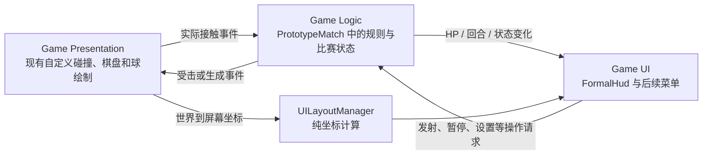

# Cosmic Bump Arena · UI 设计规范 V1.0（待确认）

本文件是设计稿，不是已实现功能说明。静态图中的 Round、倒计时、黑洞、刷新、重生、设置和结算数据均为模拟数据。主游戏、物理、皮肤与规则本轮未改。

## 1. 当前结构与评估

- 主场景 `res://main.tscn` 只有 `Lab: Node2D`，挂载 `scripts/game/PrototypeMatch.gd`；它目前同时保存比赛状态、执行自定义碰撞与伤害、绘制棋盘和球，并协调输入及视角。
- `FormalHud.gd` 是运行时创建的 `CanvasLayer` 下的 `Control`。它只读取 `game.towers`、`turn`、`moving`、`finished`、`get_view_side()` 与 `to_global()`，绘制玩家徽章和塔血条；没有写入物理或 HP。头像、昵称可替换。玩家细条目前只是视觉槽位，项目没有独立玩家 HP。
- `DeveloperPanel.gd` 是 Windows 等桌面环境的独立 `Window`。Seed、特殊球刷新与黑洞入口处于禁用占位状态；参数滑条目前直接设置 `power/drag/bounce`，这是开发工具接口，不应复制到正式 UI。
- `scripts/visuals/BallVisual.gd`、`ArenaVisual.gd` 和多个数据 Resource 由 `ArtSandbox.tscn` 使用，主场景没有实例化它们。当前不应为了分层强行迁移游戏到美术沙盒结构。
- `project.godot` 设计分辨率为 540×960，`canvas_items`、`keep`、竖屏。正式 HUD 默认无调试内容，F3/F4/F5 在桌面开发环境使用。

### 现有耦合与最小处理

1. `PrototypeMatch.gd` 中的 `_apply_tower_damage()` 更新 HP，`_add_tower_impact()` 添加特效，`FormalHud` 每帧读 `towers` 绘血条。将来先在实际 HP 变更点发一个 `tower_hp_changed(tower_id, hp, max_hp)` 信号；HUD 监听信号，碰撞代码保持原样。
2. `FormalHud` 直接依赖 `PrototypeMatch` 的字典字段。第一阶段可以保留只读访问；新增 Round、特殊状态时改用小型 `get_ui_snapshot()` 和少量状态变化信号，避免另建全局事件总线。
3. 玩家徽章位置、塔条尺寸和安全距离目前分散于 `FormalHud.gd`。当第二个正式界面接入时，再抽出纯计算型 `UILayoutManager` 与一份参数资源；不创建常驻 AutoLoad 管理器。
4. 当前蓝方视角以固定 180° 旋转，顶部主塔屏幕中心比红方视角低约 **30.1 设计像素**。静态设计稿已按同一顶部主塔锚点对齐；正式代码尚未修改。设计确认后只校正视角显示平移，并回归验证触摸映射。

## 2. 三层职责与依赖

- **Logic** 是玩家身份、阵营、回合、伤害、治疗与胜负的唯一数据来源。Seed、黑洞与刷新规则尚未实现时，不建立假状态。
- **Presentation** 保留现有物理求解和棋盘本地坐标；负责视角变换、材质与短暂特效。碰撞只报告事实，不因 HUD 排版改变世界坐标。
- **UI** 读取状态并发送操作请求，不写球速、塔 HP、回合或胜负。开发面板是独立工具，不是正式 HUD 的子组件。
- 先用明确方法与 2–4 个有用信号连接，不引入抽象基类、事件总线或三个大型管理器。

### 两条推荐数据流

1. 球撞塔：现有碰撞路径确认接触 → `_apply_tower_damage()` 按旧规则扣血 → 发 `tower_hp_changed` → HUD 更新对应塔条；表现层沿现有 `_add_tower_impact()` 显示局部受击效果。
2. UI 操作：菜单发 `pause_requested` 或调用 `request_pause()` → 比赛入口验证当前状态 → 发布 `match_state_changed` → UI 打开或关闭弹层。正式按钮不直接设置 `moving` 或 `turn`。

## 3. UI Inventory

每项按“位置；显示条件；数据来源；现状；下一步”记录。未实现项目均只存在于本轮静态图。

- **玩家头像／昵称／细状态条**：`FormalHud.gd`；上下两侧常驻、当前行动头像轻微提亮；球 ID、固定阵营映射、可替换昵称与头像；已实现圆形徽章，玩家 HP 不存在；保留组件，未来确认玩家 HP 规则后再绑定真实数值。
- **六座塔细血条**：`FormalHud.gd`；对应塔外侧常驻；`towers[i].hp`；已与真实塔 HP 绑定；以后只收敛数据接口，不改伤害规则。
- **母球待操作描边、瞄准线与非文字力度反馈**：`PrototypeMatch.gd` 世界绘制；待操作或拖拽时显示；`turn/aiming/pull`；已实现；保留视觉手感，不改蓄力参数。
- **塔受击短特效**：`PrototypeMatch.gd` 世界绘制；真实碰撞后短暂出现；接触点、速度与阵营；已实现；不移入 HUD。
- **回合／行动玩家／倒计时**：正式 HUD 顶部中轴；待操作时常驻、暂停与结算时降权；设计稿使用模拟的第 3 回合和 12 秒；当前仅有 `turn/timer`，没有独立 Round 数据；待规则确定后绑定。
- **声音与菜单入口、聊天收起入口**：正式 HUD 下方保留区；常驻；用户设置与聊天数据未接入；仅静态位置；菜单内集中暂停、退出、设置，规则说明放设置内，避免五个常驻按钮。
- **特殊球刷新提示**：棋盘上部轻量通知；仅刷新前后短暂显示；未来刷新事件；未实现逻辑；静态预览不代表已能刷新。
- **黑洞回合状态与重生提示**：棋盘上部状态条、靠近受影响玩家的短提示；仅黑洞存在或玩家等待重生时显示；未来黑洞和重生状态；未实现；不由 HUD 创建黑洞或玩家球。
- **吸血球伤害／回血反馈**：接触附近短提示；仅实际结算后显示；现有治疗结果可作数据来源；目前只有通用受击消息，正式提示未接入；以后由结果事件驱动。
- **暂停／设置／规则／重开确认／结算**：独立弹层；按请求或比赛结果显示；当前 `finished` 只有布尔值，菜单状态、获胜信息及统计未建；本轮静态预览，功能待逐项实现。
- **碰撞辅助线、UI 边框、Seed/FPS 与调参工具**：`DeveloperPanel.gd` 和 `PrototypeMatch.gd` 调试绘制；仅桌面开发模式；实时调试数据，Seed/黑洞测试仍禁用；与正式界面隔离，不进入手机正式画面。

## 4. UILayoutManager 最小方案

复用现有 `FormalHud` 的 `CanvasLayer + Control + HBoxContainer`。设计确认、第二种正式组件接入时再新增一个**无节点、无全局状态**的 `UILayoutManager.gd`（`RefCounted`）和可编辑的布局参数 Resource。

输入：逻辑视口尺寸、设备安全区换算值、本地阵营侧、棋盘显示变换、六个塔的世界圆心。输出：玩家徽章中心、状态条矩形、塔条位置、顶部状态与底部预留区矩形。它不读取或修改 HP、球速、回合及玩家分配。

关键参数初稿，单位均为 540×960 设计像素：

- `avatar_diameter=36`；左右头像中心 `x=145/395`。
- `player_name_size=13`；玩家细条 `70×2`；主塔细条 `52×3`；副塔细条 `34×3`。
- `safe_top=28`、`safe_bottom=28`；上排头像中心 `y≈50`、下排头像中心 `y≈751`。
- `reserved_chat_space=123`；聊天收起条约 `x=94..446, y=875..918`。
- 棋盘当前显示偏移 `-52`，仅属于视角呈现；物理棋盘仍使用原始局部坐标。设计稿上下主塔屏幕锚点约为 `y=149/677`，红蓝一致。
- 顶部状态胶囊 `x=214..326, y=28..82`。临时通知出现在棋盘上沿以内，不长期占位。
- 设备安全边距换算后取 `max(设计边距, 实际安全区/S)`，其中 `S` 为等比显示缩放；空间不足时先收紧 HUD 间距，再考虑整体等比缩放，绝不修改碰撞几何。

## 5. 统一视觉规范

- 竞技区始终保持 540×960 逻辑画幅与现有棋盘等比呈现，银河棋盘为视觉中心。
- 圆形玩家徽章使用细描边：蓝 `#72D9F3`、红 `#FF8AA7`；当前行动只加粗约 0.8 像素并稍提高文字亮度，不加光晕。
- 主文字 `#F3EDF9`，次文字 `#C4B8D8`，少量关键瞄准反馈 `#E9D19B`。底衬为深紫，透明度根据用途约 0.47–0.95；常驻 HUD 使用低透明度，不使用厚重玩家卡片。
- 字号层级：弹层标题 21，按钮 15，昵称与回合 13，状态或通知 10–12（设计像素）。
- 顶部玩家、底部玩家、塔条、状态胶囊与底部入口共用一套尺寸及边距参数。弹层统一圆角、留白与按钮高度 36。
- 主画面只放“音效”和“菜单”两个小圆按钮及收起的聊天入口；菜单内放暂停、设置、退出，设置内放规则说明。按钮正式功能待设计确认后接入。

## 6. 状态显示规则与静态预览

所有预览由同一棋盘皮肤、同一 Godot 字体、同一 HUD 参数生成；主游戏未加载这些预览脚本。

1. `01_normal_blue.png`：蓝队在下，常规对局；模拟 Round 3、12 秒。
2. `02_normal_red.png`：红队在下，与蓝方使用相同主塔锚点和 HUD 模板。
3. `03_aiming.png`：保留方向线和无文字力度段，底部入口不挡拖拽。
4. `04_special_spawn.png`：短暂刷新通知；仅在未来真实刷新事件触发。
5. `05_black_hole.png`：黑洞剩余回合和等待重生提示；均为设计模拟。
6. `06_pause.png`：遮罩下保留棋盘辨识；继续、设置、退出集中在弹层。
7. `07_settings.png`：音乐、音效、触感与规则入口；当前只是设计图。
8. `08_result.png`：胜利结算示例；失败共用同一弹层模板、替换文案与色调。

常规和瞄准保留玩家徽章与塔条；特殊状态只在事件存在时出现；弹层打开时世界输入应停止，关闭时恢复。倒计时、提示与特效不得遮挡球或塔的接触位置。

## 7. 确认后的逐模块实施顺序

1. 冻结本文件的布局参数和红蓝视角锚点；仅修正蓝视角约 30.1 像素的显示平移，测试触摸方向和画面裁切。
2. 将顶部状态胶囊、底部入口与统一布局计算接入 `FormalHud`；保留当前世界脚本和自定义物理。
3. 从现有伤害、回合与结算点发布少量明确信号，塔条、计时和行动玩家绑定真实数据；不重复计算伤害。
4. 为暂停与设置建立请求接口，逐个接入声音、规则和退出确认；开发面板继续独立。
5. 当刷新、黑洞、重生等**真实规则**实现后，再逐个接入各自的短暂提示；不由静态图倒推玩法。
6. 统一做竖屏安全区、红蓝视角、拖拽、碰撞和界面遮挡回归测试。

设计确认之前，不修改主游戏实现，也不部署 Web。
