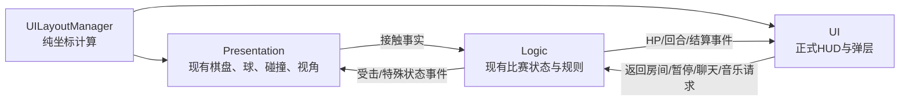

# Cosmic Bump Arena · HUD V2 设计规范（待确认）

本轮已把红蓝视角的棋盘屏幕锚点统一，并制作 Godot 静态预览。聊天、图片、表情、共享音乐、等待房间及其弹层均为**设计模拟**；项目没有相应的服务器、房间或同步功能。皮肤、塔和球的世界坐标、碰撞与伤害规则未改。

## 1. 棋盘错位的根因与修复

原实现以 `Vector2(270, 480)` 所在的视口中线作为 180° 翻转基准，同时给两种视角使用同一个 `-52` 纵向偏移。棋盘上下主塔的几何中心实际位于世界坐标 `y≈464.97`，比视口中线高约 `15.03`；翻转后屏幕位置差距是两倍，约 `30.06` 设计像素。

现用上下主塔世界坐标的中点作为**共同几何锚点**，红蓝都通过同一个变换公式映射到分配给棋盘的显示区中心 `(270,443)`。显示区初稿为 `(0,110)–(540,776)`，延续原蓝方视角的位置；这不是将棋盘强行放在整屏中心，也没有给阵营各写一个 Y 修正值。

- 蓝方在下：顶部、底部主塔屏幕中心分别为 `(270.00,179.06)`、`(270.00,706.94)`。
- 红方在下：同样分别为 `(270.00,179.06)`、`(270.00,706.94)`。
- 两视角旋转和位移不同，但统一缩放均为 `1.0`，世界内球体与塔坐标未变。
- `scripts/ui/UILayoutManager.gd` 保存纯布局参数，`PrototypeMatch.gd` 只取棋盘目标锚点设置显示变换；这不会改动碰撞计算。

## 2. 五个屏幕区域与锚点（540×960 设计像素）

1. **系统操作区**：左上返回按钮中心 `(46,50)`；中间回合胶囊 `(204,29,132,42)`；右上菜单中心 `(494,50)`。正式预览无开发文字。
2. **对方玩家 HUD**：左右中心 X 为 `145/395`，排顶 Y 为 `91`；头像圆心 Y=`113`、直径 `36`，昵称基线约 `149`，细状态条 Y=`157`、`70×2`。
3. **棋盘游戏区域**：分配显示区 `(0,110,540,666)`、屏幕锚点 `(270,443)`。主塔中心 Y=`179.06/706.94`；棋盘与世界坐标维持等比、同一物理几何。
4. **己方玩家 HUD**：与上排同尺寸、同 X；排顶 Y=`729`；头像圆心 Y=`751`，昵称基线 `787`，细状态条 Y=`795`。己方阵营身份只改变数据绑定和世界观察方向。
5. **底部社交区**：聊天胶囊 `(28,871,298,44)`；音乐按钮中心 `(374,893)`；表情按钮中心 `(462,893)`。图标可小于操作区，最终触摸矩形按 `max(44, 44/S)` 个设计像素计算，`S` 是设计像素到 CSS 像素的等比缩放，以保证至少约 44 CSS 像素。三入口之间保留间隔；不要用大底板填满整个底部。

六座塔继续由自身世界圆心投影到屏幕后定位细血条，主塔 `52×3`、副塔 `34×3`；血条只读对应塔的真实 HP。玩家细条目前没有独立玩家 HP 数据，仅为视觉槽位，不能伪装成真实血量。

顶/底安全区按 `max(28, 设备安全区像素/S)` 换算。安全区较大时优先压缩 HUD 间距或收起非关键入口；需要缩放时仅等比缩放游戏显示，不改世界物理坐标。`UILayoutManager` 是无节点、无全局状态的纯计算模块，不能负责伤害、回合或房间身份。

## 3. 视觉系统与复用组件

- 延续 V1 的圆形极简徽章：深紫轻透底，主字 `#F3EDF9`，次字 `#C4B8D8`，蓝 `#72D9F3`、红 `#FF8AA7`，必要高亮 `#E9D19B`；不加持续光晕、大玩家卡片或中间法官模块。
- 玩家头像直径 `36`，昵称 `13`，玩家细条 `70×2`；塔细条如上。顶部回合 `12`，按钮文字 `14–15`，提示 `10–12`，弹层标题 `20–21`。
- 常驻系统入口视觉圆直径 `42`，触摸区至少 `44 CSS px`；弹层采用一致圆角、间距和按钮高约 `36` 设计像素，实际接入时扩大其透明可点区域。
- 复用现有 `PlayerHUD`（当前在 `FormalHud.gd` 内绘制）及塔条；新增的 `BackToRoomButton`、`LeaveMatchConfirmDialog`、`ChatBar`、`ChatInputPanel`、`ImagePickerEntry`、`EmojiPicker`、`QuickReactionDisplay`、`SharedMusicButton`、`MusicPanel` 可先做小型 Control 场景，不为每个控件建管理器。
- 菜单、暂停、设置、规则和结算共用弹层容器。开发面板继续是桌面独立 Window，正式 HUD 不依赖它。

## 4. 交互状态

### 返回房间

左上按钮 → “退出对局？”轻量确认 → 取消 / 返回房间。确认按钮未来发出 `return_to_room_requested(match_id)`；只有房间上下文存在且导航成功后才关闭对局视图。当前没有等待房间，设计稿的目标页与导航均未接入。

### 聊天与图片

默认只显示“聊天…”胶囊，可用小圆点提示未读。点击展开底部输入层：输入框、表情、图片、发送、收起；发送中、发送失败与重试是同一消息组件的状态。中文输入法组合输入期间不将未确认字串发送，按发送或键盘完成键才提交。图片入口走系统图片选择，先显示缩略图与文件名，确认或取消；失败时保留缩略图并提供重试，不在本轮上传或同步。

**键盘策略：**固定棋盘的世界显示变换，键盘弹出时只把聊天输入层贴在可见区域上方，并暂时禁止棋盘拖拽输入。对局计时是否暂停属于后续规则决定，UI 不擅自改回合计时。移动 Web 适配时监听 `VisualViewport` 的尺寸与偏移，避免把软键盘高度误当成世界坐标变化；键盘可缩小可见视口但不一定改变布局视口。[MDN VisualViewport](https://developer.mozilla.org/en-US/docs/Web/API/VisualViewport) 说明了两种视口的区别。静态键盘图仅为排版示意，iPhone Safari 与 Android Chrome 的真实软键盘仍需真机检查；Apple 也指出桌面响应式预览不能替代真实设备的键盘行为。[Apple Responsive Design Mode](https://developer.apple.com/documentation/safari-developer-tools/responsive-design-mode)

### 快捷表情

黄色微型笑脸打开紧凑面板：最近、心情、鼓励分类，可左右切页；本版用程序绘制的原创占位笑脸，不含贴吧素材。点选即发，面板关闭。短暂贴纸靠近发言玩家出现，设计目标约 2 秒淡出；同一玩家连续发送时合并或覆盖旧贴纸，并限制同时可见数，不覆盖球体活动核心区域。图片资源以后可替换，组件布局不必重做。

### 房间共享音乐

音乐符号打开底部轻面板：选曲、播放/暂停、当前曲目、房间共享状态、个人音量/静音。当前仅显示“待接入”。以后需要明确音乐来源和许可、统一播放进度与延迟补偿；浏览器中的有声播放通常需要用户交互后启动，并需处理被拦截的播放请求。[MDN 媒体自动播放指南](https://developer.mozilla.org/en-US/docs/Web/Media/Guides/Autoplay) 本轮不接入音频传输或同步。

## 5. 三层数据流与轻量接口

现阶段继续复用 `PrototypeMatch.gd`，仅在实际状态变更点逐步加入 `tower_hp_changed`、`turn_changed`、`match_finished` 等必要信号。社交功能未来由独立服务处理消息和音乐数据，HUD 只发请求、读状态；不让 HUD 直接设置球速、塔 HP 或物理坐标。未实现的房间/黑洞/刷新后端，不因出现设计稿就创建伪状态。`UILayoutManager` 仅计算锚点与安全区，不是逻辑管理器。

## 6. Godot 静态预览与显示条件

同一个 `main.tscn`、皮肤、字体和 V2 布局参数生成 19 张 540×960 图。`01` 蓝队在下、`02` 红队在下；`03` 蓄力、`04` 特殊球刷新、`05` 黑洞、`06` 暂停、`07` 设置、`08` 结算；`09` 常规社交入口带未读点；`10` 聊天展开、`11` 键盘、`12` 图片确认、`13` 表情面板、`14` 发送反馈、`15` 音乐面板、`16` 返回房间确认；补充 `17` 选曲、`18` 图片发送失败、`19` 等待房间页面。除回合、塔 HP 和球的现有画面数据外，面板里的功能内容都是模拟数据。

可开关的提示只在相应事件出现时短暂显示；输入层和弹层打开时不显示额外开发按钮。键盘图通过临时遮罩和模拟键盘说明交互区域，正式实现要使用系统键盘。

## 7. 后续实施顺序

1. 用户确认本 V2 视觉与区域锚点，特别是上下玩家 HUD、底部社交区与棋盘间距。
2. 将静态的系统入口和底部社交入口做成真实 Control，先只实现打开/关闭，不改变对局规则。
3. 接入已有回合、塔 HP、倒计时数据的只读信号；玩家 HP 规则确认前不接假数据。
4. 做返回房间的本地导航协议与等待房间页面；服务器或多人房间另行实施。
5. 逐个实现聊天输入、图片、表情本地状态，再考虑网络与存储。
6. 评估合法音乐来源和浏览器播放限制，再接入房间共享同步。
7. 在实际手机 Web 环境中测试安全区、键盘、触摸和红蓝视角；本轮未重新导出或部署 Web。

本轮未对棋盘皮肤、碰撞边界、球体物理、塔坐标或伤害规则作任何修改。
